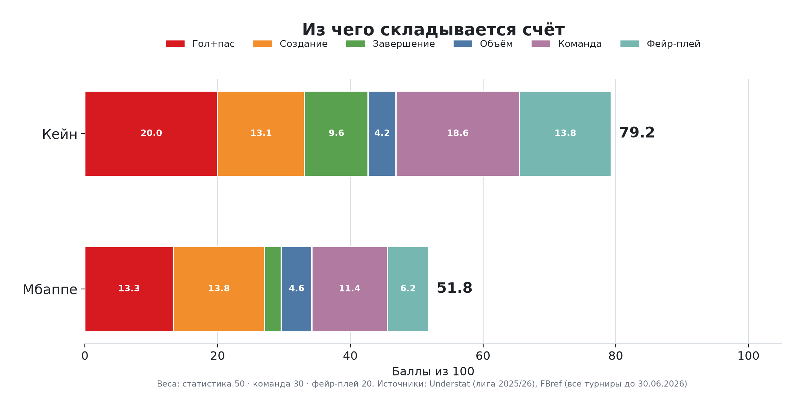
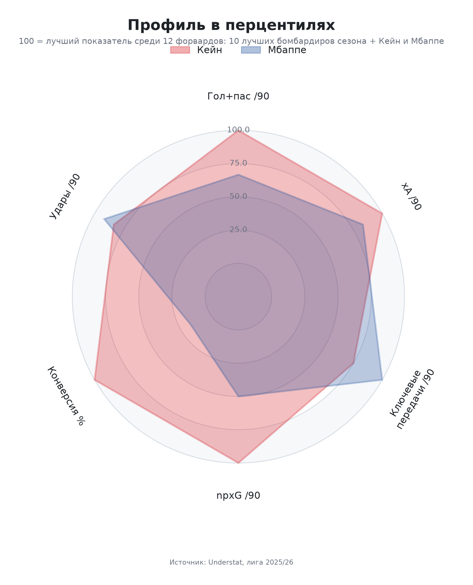
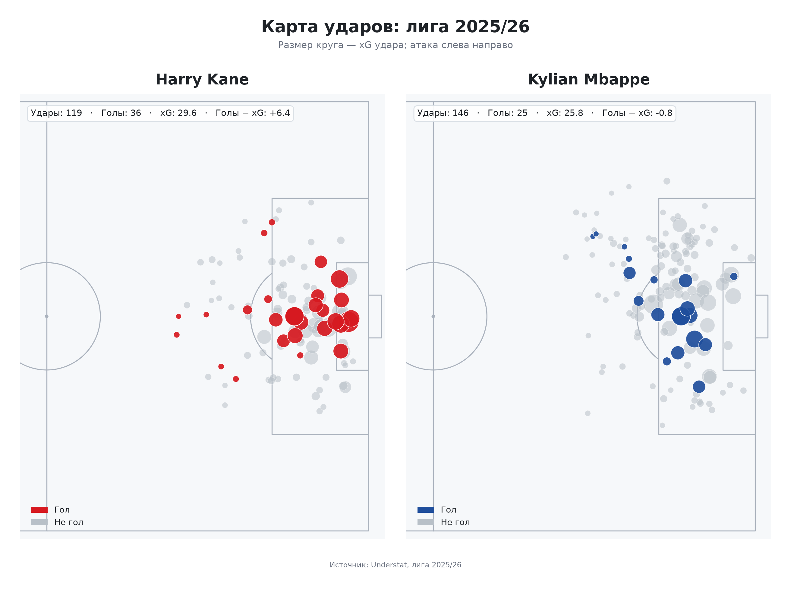
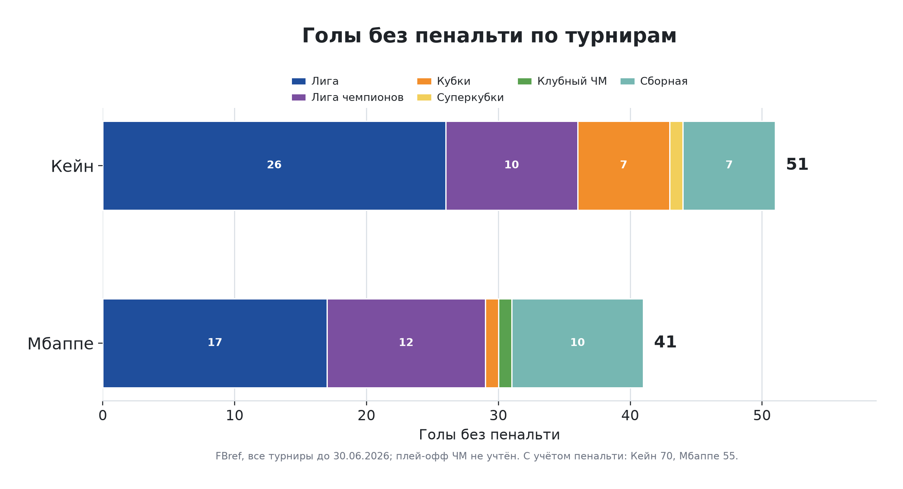
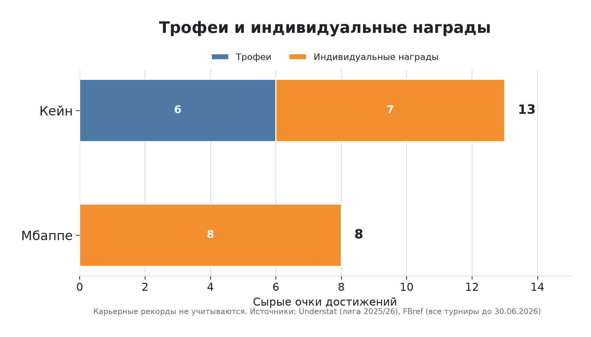
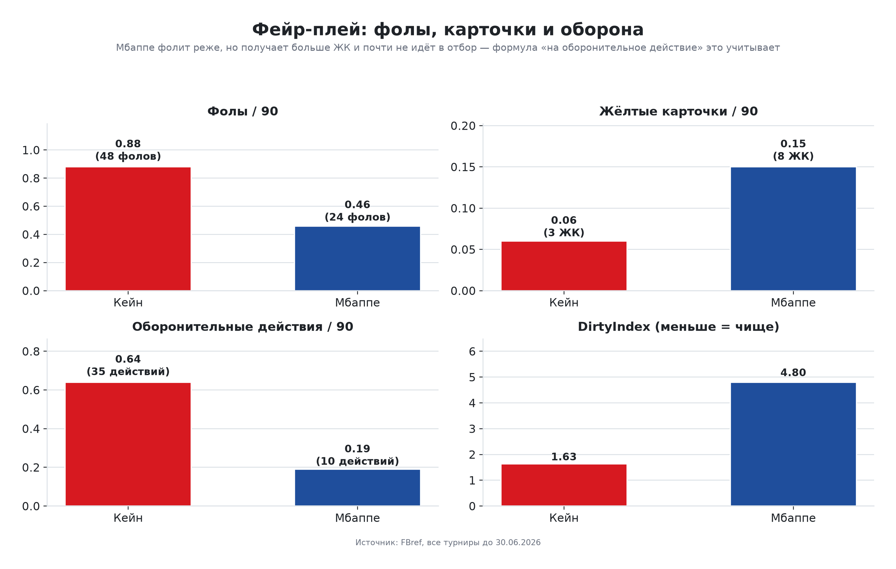
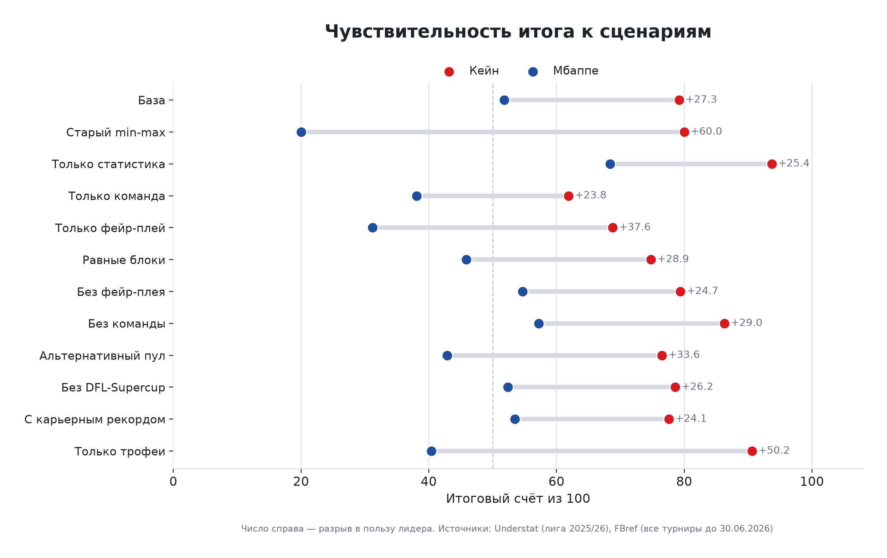
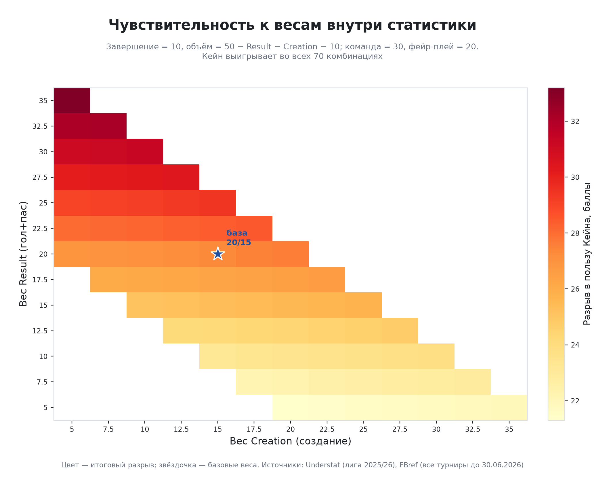

# Авторская система оценки претендентов на «Золотой мяч»: кейс Кейн vs Мбаппе, сезон 2025/26

Я сконструировал авторскую систему оценки кандидатов на «Золотой мяч» по критериям France Football. Система переводит три критерия, а именно индивидуальные выступления, командные достижения, класс и фейр-плей, в прозрачную 100-балльную модель: собирает открытые данные, считает показатели на 90 минут без пенальти, нормирует их внутри группы форвардов (или игроков аналогичной позиции, если, например, оценивается защитник), добавляет трофеи, награды и дисциплину и проверяет, насколько итог зависит от выбранных весов. Испытана она на споре «Кейн или Мбаппе» в сезоне 2025/26.

> **Это независимая учебная разработка, не связанная с France Football. Она не прогнозирует голосование и не утверждает «кто лучше вообще».** Все веса, формулы и допущения открыты, а ограничения перечислены ниже.

**Результат применения: Кейн 79,20, Мбаппе 51,85 из 100 (разрыв 27,35).** Кейн выигрывает в базовой модели, во всех 12 сценариях и во всех проверенных комбинациях весов. При этом размер разрыва зависит от допущений и определён неточно (см. [Ограничения](#ограничения-и-известные-неточности)).



## Содержание

1. [Полный отчёт](#полный-отчёт)
2. [Система оценки](#система-оценки)
3. [Данные и источники](#данные-и-источники)
4. [Применение к кейсу Кейн vs Мбаппе](#применение-к-кейсу-кейн-vs-мбаппе)
5. [Проверка чувствительности](#проверка-чувствительности)
6. [Выводы](#выводы)
7. [Допущения](#допущения)
8. [Ограничения и известные неточности](#ограничения-и-известные-неточности)
9. [Как воспроизвести](#как-воспроизвести)
10. [Структура репозитория](#структура-репозитория)
11. [Что бы я сделал иначе](#что-бы-я-сделал-иначе)
12. [Данные и лицензия](#данные-и-лицензия)

## Полный отчёт

*Этот README — краткое изложение: система оценки, ключевые таблицы, графики и выводы. Полный отчёт с кодом и всеми таблицами лежит отдельно, в ноутбуке **`analysis.ipynb`**. Рекомендую сначала ознакомиться с README, а уже потом посмотреть отчёт.*

| Что сделать | Как |
|---|---|
| Прочитать отчёт | [Открыть `analysis.ipynb`](analysis.ipynb): GitHub показывает ноутбук прямо в браузере |
| Скачать отчёт | [Открыть исходный файл](analysis.ipynb?raw=true) и сохранить (`Ctrl+S`) либо склонировать репозиторий; открывается в Jupyter или VS Code |
| Пересчитать | см. [Как воспроизвести](#как-воспроизвести) |

## Система оценки

### Идея

Критерии «Золотого мяча» размыты. По описанию France Football их три, в порядке убывания важности: индивидуальные выступления, командные достижения, класс и фейр-плей. Я перевёл их в модель из трёх блоков:

| Блок | Вес | Что внутри |
|---|---:|---|
| Индивидуальная статистика | 50 | Result 20 · Creation 15 · Finishing 10 · Volume 5 |
| Командные достижения и награды | 30 | трофеи сезона и индивидуальные награды |
| Фейр-плей | 20 | жёлтые карточки и фолы на оборонительное действие |

Значения 50/30/20 — мой выбор: порядок блоков следует критериям, а числа ничем внешним не обоснованы. Поэтому в проекте они проверяются сетками весов, а не объявляются «единственно верными».

Принципы системы:

- Критерии берутся для позиции форварда (от «гол + пас» до ожидаемой угрозы): сравнивать игроков одной позиции проще и честнее.
- Все показатели считаются на 90 минут и без пенальти.
- Статистика нормируется перцентилями внутри группы из 12 форвардов, а не сырыми суммами.
- Командный блок и фейр-плей считаются как доли от суммы двух игроков.
- Каждое допущение явное, а устойчивость итога проверяется отдельно.

### Формулы

```text
NPG+A/90        = (голы без пенальти + ассисты) / минуты * 90
Conversion      = голы без пенальти / удары без пенальти * 100
Overperformance = голы без пенальти - npxG

Result    = перцентиль(NPG+A/90)
Creation  = среднее(перцентиль(xA/90), перцентиль(ключевые передачи/90))
Finishing = среднее(перцентиль(Conversion), перцентиль(Overperformance))
Volume    = перцентиль(удары без пенальти/90)

DirtyIndex  = 3 * ЖК / (TklW + Int) + Фолы / (TklW + Int)
clean       = 1 / (1 + DirtyIndex)
FairPlay    = 100 * clean_игрока / сумма(clean двух игроков)
Team        = 100 * очки_игрока / сумма(очков двух игроков)

Итог = (20*Result + 15*Creation + 10*Finishing + 5*Volume + 30*Team + 20*FairPlay) / 100
       (каждый блок выражен в процентах, 0-100)
```

### Нормировка

Статистика переводится в перцентили внутри группы из 12 форвардов (`scipy.stats.percentileofscore`, `kind="rank"`). Командный блок и фейр-плей считаются как доля от суммы двух игроков, поэтому сохраняют величину разрыва и не превращаются в 0/100. Первая версия использовала min-max по двум игрокам, и каждый блок получался 0/100: итог выходил 80:20. Эта версия сохранена в проверке чувствительности как сценарий «Старый min-max».

### Группа сравнения

Кейн, Мбаппе и десять форвардов топ-5 лиг с наибольшим числом голов: Холанд, Мурики, Тьяго, Леполь, Ундав, Лаутаро Мартинес, Гирасси, Будимир, Семеньо, Шик. Форвардом считается игрок, у которого в позиции Understat есть «F». Для проверки чувствительности есть альтернативный пул: десять игроков с лучшим показателем (голы + ассисты)/90 при минимуме 1500 минут.

### Что по каким данным считается

Индивидуальная статистика — только по лиге (Understat). Все турниры (FBref) используются как контекст и для фейр-плей.

## Данные и источники

| Источник | Что даёт | Файлы | Как получено |
|---|---|---|---|
| Understat | таблицы игроков топ-5 лиг 2025/26, xG/xA, ключевые передачи | `data/raw/understat/all_players_2025.csv`, `data/raw/Kane/`, `data/raw/Mbappe/` | `fetch_understat.py` (сеть), выгрузки таблиц игроков |
| Understat | координаты и xG каждого удара | `data/raw/understat/shots_*.csv` | `fetch_understat.py` |
| FBref | матчи по всем турнирам: голы, ассисты, карточки, фолы, отборы, перехваты | `data/raw/Kane/KaneFBRef.csv`, `data/raw/Mbappe/MbappeFBRef.csv` | выгрузки лежат в репозитории, скрипта загрузки FBref нет |
| Ручной ввод | трофеи и индивидуальные награды | `data/raw/trophies.csv`, `data/raw/awards.csv` | вручную |

Выгрузка Understat сделана 27.10.2026, данные FBref заканчиваются 30.06.2026. FBref использован только для базовой статистики: по публикациям, с января 2026 года сайт больше не показывает продвинутые метрики (xG и др.) из-за прекращения договора с поставщиком Opta. Поэтому xG и xA есть только для лиги и только из Understat.

## Применение к кейсу Кейн vs Мбаппе

Оба игрока — нападающие, поэтому критерии для форварда применимы к ним одинаково. Дальше — шесть этапов оценки, как в ноутбуке.

### Этап 1. Индивидуальная статистика в лиге

Источник: Understat, сезон 2025/26, только лига.

| Показатель | Кейн | Мбаппе |
|---|---:|---:|
| Минуты | 2 385 | 2 623 |
| Голы (из них без пенальти) | 36 (26) | 25 (17) |
| Ассисты | 5 | 5 |
| npxG | 21,25 | 19,11 |
| Голы без пенальти − npxG | +4,75 | −2,11 |
| Конверсия ударов без пенальти | 24,1 % | 12,4 % |
| Гол + пас без пенальти на 90 | 1,17 | 0,75 |
| xA на 90 | 0,28 | 0,25 |
| Ключевые передачи на 90 | 1,51 | 2,23 |
| npxG на 90 | 0,80 | 0,66 |
| Удары без пенальти на 90 | 4,08 | 4,70 |

Перцентили внутри группы из 12 форвардов (100 — лучший ранг в группе):

| Игрок | Гол+пас /90 | xA /90 | Ключевые передачи /90 | npxG /90 | Удары /90 | Конверсия | Голы − npxG |
|---|---:|---:|---:|---:|---:|---:|---:|
| Кейн | 100,0 | 100,0 | 75,0 | 100,0 | 83,3 | 100,0 | 91,7 |
| Мбаппе | 66,7 | 83,3 | 100,0 | 50,0 | 91,7 | 16,7 | 33,3 |

Кейн — очевидный финишёр: выше конверсия, результативность и npxG. Мбаппе компенсирует это созданием и объёмом: больше ключевых передач и ударов, но заметно ниже реализация.



Карта ударов: каждый круг — удар, размер пропорционален xG, цвет показывает гол или не гол.



### Этап 2. Контекст: все турниры

Источник: FBref, до 30.06.2026. Эти данные показывают общий объём сезона и не входят в индивидуальный счёт: для них нет xG/xA в одном источнике.

| | Кейн | Мбаппе |
|---|---:|---:|
| Матчи | 62 | 59 |
| Минуты | 4 908 | 4 667 |
| Голы (из них пенальти) | 70 (19) | 55 (14) |
| Голы без пенальти | 51 | 41 |
| Ассисты | 7 | 11 |
| Удары | 228 | 265 |
| Жёлтые карточки | 3 | 8 |
| Фолы | 48 | 24 |
| Выигранные отборы (TklW) | 22 | 4 |
| Перехваты | 13 | 6 |

Статистика ЧМ в расчёт не вошла: данные обрезаны на 30.06.2026.



### Этап 3. Командные достижения и награды

| Игрок | Трофеи | Награды | Всего | Доля |
|---|---:|---:|---:|---:|
| Кейн | 6 (Бундеслига 3, Кубок Германии 2, Суперкубок Германии 1) | 7 (лучший игрок Бундеслиги 2, лучший бомбардир Бундеслиги 2, «Золотая бутса» Европы 3) | 13 | 61,9 % |
| Мбаппе | 0 | 8 («Золотая бутса» ЧМ 3, «Золотая бутса» ЛЧ 3, лучший бомбардир Ла Лиги 2) | 8 | 38,1 % |

Веса трофеев: чемпионаты и ЛЧ, ЧМ — 3, национальные кубки и клубный ЧМ — 2, суперкубки — 1. Награды: «Золотая бутса» — 3, лучший игрок — 2, лучший бомбардир — 2, прочие — 1. Карьерные рекорды в счёт не идут.



### Этап 4. Фейр-плей

Абсолютные фолы и карточки несправедливы к игроку, который много работает без мяча, поэтому показатель привязан к оборонительным действиям (выигранные отборы + перехваты).

| Игрок | ЖК | Фолы | Оборонительные действия (TklW + Int) | DirtyIndex | Доля «чистоты» |
|---|---:|---:|---:|---:|---:|
| Кейн | 3 | 48 | 35 | 1,629 | 68,8 % |
| Мбаппе | 8 | 24 | 10 | 4,800 | 31,2 % |

Мбаппе фолит реже в абсолютных числах, но и вступает в отбор и перехват заметно реже, поэтому на одно оборонительное действие у него приходится больше фолов и карточек.



### Этап 5. Итоговый счёт

| Блок | Вес | Кейн | Мбаппе | Кейн − Мбаппе |
|---|---:|---:|---:|---:|
| Result | 20 | 20,000 | 13,340 | +6,660 |
| Creation | 15 | 13,125 | 13,755 | −0,630 |
| Finishing | 10 | 9,580 | 2,500 | +7,080 |
| Volume | 5 | 4,165 | 4,585 | −0,420 |
| **Индивидуальная статистика** | **50** | **46,870** | **34,180** | **+12,690** |
| **Командные достижения** | **30** | **18,570** | **11,430** | **+7,140** |
| **Фейр-плей** | **20** | **13,760** | **6,240** | **+7,520** |
| **Итого** | **100** | **79,200** | **51,850** | **+27,350** |

Кейн выигрывает Result, Finishing, командный блок и фейр-плей. Мбаппе выигрывает Creation и Volume, но вместе они дают ему лишь около 1 балла. График итогового счёта был в начале README.

## Проверка чувствительности

Этап 6. Результат проверяется на двух уровнях.

**1. Сценарии (12).**

| Сценарий | Кейн | Мбаппе | Разрыв |
|---|---:|---:|---:|
| База (50/30/20, основной пул) | 79,2 | 51,8 | 27,3 |
| Старый min-max | 80,0 | 20,0 | 60,0 |
| Только статистика | 93,7 | 68,4 | 25,4 |
| Только команда | 61,9 | 38,1 | 23,8 |
| Только фейр-плей | 68,8 | 31,2 | 37,6 |
| Равные блоки (33/33/33) | 74,8 | 45,9 | 28,9 |
| Без фейр-плея (55/45/0) | 79,4 | 54,7 | 24,7 |
| Без команды (70/0/30) | 86,3 | 57,2 | 29,0 |
| Альтернативный пул | 76,5 | 42,9 | 33,6 |
| Без DFL-Supercup | 78,6 | 52,4 | 26,2 |
| С карьерным рекордом (+2 Мбаппе) | 77,6 | 53,5 | 24,1 |
| Только трофеи | 90,6 | 40,4 | 50,2 |



**2. Сетки весов.**

| Сетка | Что меняется | Комбинаций | Разрыв | Победитель |
|---|---|---:|---|---|
| Основные блоки | статистика 40–60, команда 20–40, фейр-плей — остаток, шаг 2,5 | 81 | 24,7–30,0 | Кейн везде |
| Внутри статистики | Result и Creation 5–35, Finishing = 10, Volume = остаток | 70 | 21,3–33,2 | Кейн везде |



Значит, победитель устойчив к выбору весов **внутри этой модели**.

## Выводы

1. **По этой модели Кейн сильнее по совокупности критериев:** 79,20 против 51,85. Он лучше в завершении (конверсия 24,1 % против 12,4 %, «голы − npxG» +4,75 против −2,11) и в результативности (1,17 против 0,75 гола и паса без пенальти на 90).
2. **Мбаппе не слабее по всем пунктам.** Он лучше в создании (2,23 ключевой передачи на 90 против 1,51) и наносит больше ударов (4,70 против 4,08 на 90). Но эти преимущества дают ему около 1 балла в сумме.
3. **Командный блок** добавляет Кейну 18,57 против 11,43: трофеи (Бундеслига, Кубок Германии, Суперкубок) и награды.
4. **Фейр-плей — самый спорный блок,** но победу Кейна он не создаёт: в сценарии без фейр-плея разрыв 24,7, с ним — 27,3.
5. **Ответ устойчив внутри модели.** Кейн выигрывает все 12 сценариев, все 81 комбинацию основных весов и все 70 комбинаций внутри статистики; минимальный разрыв — 21,3.
6. **Нормировка важна.** Старая min-max давала 80:20, потому что превращала любой перевес в 0/100. Перцентили и доли дают более умеренный разрыв, но тоже определяют его неточно.

Итог: в рамках выбранной системы Кейн впереди при любых проверенных весах, но число 27,35 — ориентир, а не измерение (см. [Ограничения](#ограничения-и-известные-неточности)).

## Допущения

- Бундеслига и Ла Лига равны по силе, поправки на силу соперников нет.
- Индивидуальная статистика считается по лиге: для остальных турниров нет полного набора xG/xA в одном источнике.
- Статистика ЧМ не учитывается (данные обрезаны), индивидуальные награды ЧМ учитываются.
- Карьерные рекорды (например, лучший бомбардир сборной Франции за всё время) не учитываются: это сравнение сезона, а не карьеры.
- Пул из десяти форвардов и веса 50/30/20 — авторский выбор.
- Один сезон, два игрока.

## Ограничения и известные неточности

- **Размер разрыва неточен.** Блоки считаются по рангам в группе из 12 игроков, часть показателей шумит, а веса выбраны мной. Число 27,35 — ориентир, а не измерение.
- **Часть расчётов считает одно и то же дважды.** Голы входят в Result, Finishing и (через награды) в командный блок.
- **Самые спорные блоки — фейр-плей и командный.**
- **Ручные данные без источников.**
- **Проверка чувствительности варьирует почти только веса.**

### Технические замечания к коду и данным

- В `all_players_2025.csv` 82 строки с повторяющимся `id` (игроки, сменившие клуб в сезоне). Код их не объединяет и правило выбора строки не описывает; на два используемых пула это не повлияло.
- В `pool_candidates.csv` колонка `G+A_p90` заполнена только у части строк (на скоринг не влияет: показатель пересчитывается заново).
- В `TROPHY_WEIGHTS` ключ `"world cup"` стоит раньше `"club world cup"`, а поиск идёт по подстроке, поэтому «Club World Cup» получил бы 3 очка вместо 2. В текущих данных такого трофея нет, на результат не влияет.
- `DirtyIndex` считается по неокруглённым отношениям, а «чистота» — по уже округлённому `DirtyIndex`. На текущие числа это не влияет.
- В `fetch_understat.py` нет повторных попыток и ограничения частоты запросов (15 запросов к `getPlayerData` идут подряд), кэш не проверяется и перезаписывается при каждом запуске, ID игроков зашиты в код.
- В `fetch_meta.json` русский текст записан с проблемами кодировки, в выгрузках FBref в поле `Result` встречается `–` вместо тире. На числовые колонки это не влияет.
- В репозитории нет тестов, CI, lock-файла и проверки схемы входных CSV; в `requirements.txt` указаны только нижние границы версий.
- Запуск ноутбука целиком («Run All») пересчитывает и **перезаписывает** `data/clean/*.csv` и `figures/*.png`.

## Как воспроизвести

Проверено на Python 3.14.7 (Windows): pandas 3.0.6, numpy 2.5.3, matplotlib 3.11.2, mplsoccer 1.8.1, scipy 1.18.1, requests 2.34.2, jupyter 1.1.1.

```bash
python -m pip install -r requirements.txt

python load_clean.py data/raw/Kane --player "Harry Kane"
python load_clean.py data/raw/Mbappe --player "Kylian Mbappe"

# необязательно: обновить кэш Understat (нужна сеть, перезапишет data/raw/understat/*)
python fetch_understat.py

python metrics.py   # на 90 минут, перцентили, все турниры, фейр-плей
python scores.py    # баллы, сценарии, сетки чувствительности
python plots.py     # figures/*.png
```

Сеть нужна только для `fetch_understat.py`: закоммиченного кэша достаточно, чтобы пересчитать баллы и графики. Итоговый отчёт: [`analysis.ipynb`](analysis.ipynb). Он сам вызывает `metrics.save_all()`, `scores.main()` и `plots.plot_all()`, поэтому его можно выполнить целиком.

## Структура репозитория

```text
├── analysis.ipynb          # полный отчёт
├── fetch_understat.py      # загрузка данных Understat, формирование пулов
├── load_clean.py           # очистка таблиц игрока из Understat
├── metrics.py              # метрики на 90 минут, перцентили, фейр-плей
├── scores.py               # блоки, итоговый счёт, сценарии и сетки чувствительности
├── plots.py                # графики
├── requirements.txt
├── data/
│   ├── raw/                # выгрузки Understat и FBref, ручные trophies.csv и awards.csv
│   └── clean/              # очищенные таблицы, метрики, баллы, результаты чувствительности
└── figures/                # 8 графиков: радар, карты ударов, счёт, команда, голы по турнирам,
                            # фейр-плей, сценарии, тепловая карта чувствительности
```

## Что бы я сделал иначе

- Взял бы пул не из 10, а из 50–100 форвардов (например, всех с минимумом минут), независимо от голов.
- Учёл бы больше статистики и во всех турнирах, а не только в лиге.
- Не использовал фейр-плей как заменитель оценки обороны: оборону описал бы отдельным блоком (если бы сравнивал реальные показатели статистики, а не фейр-плей)
- Добавил бы в репозиторий проверку шума (симуляция по xG или bootstrap) и обратный анализ: при каких весах победил бы Мбаппе.
- Проверил бы модель на прошлых сезонах, где итог голосования известен.
- Добавил бы источники к ручным данным, тесты, lock-файл и повторные попытки сетевых запросов.

## Данные и лицензия

Исходные данные взяты из открытого доступа; права на них принадлежат Understat и FBref (Sports Reference). Проект учебный и некоммерческий, данные приведены только для воспроизводимости расчётов. Лицензия на код не указана.
